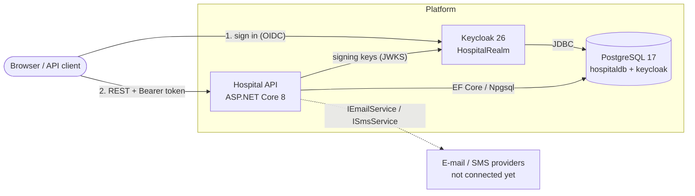
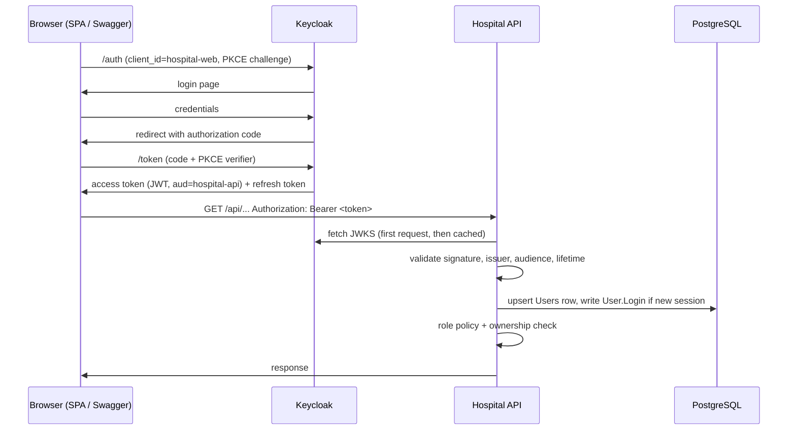
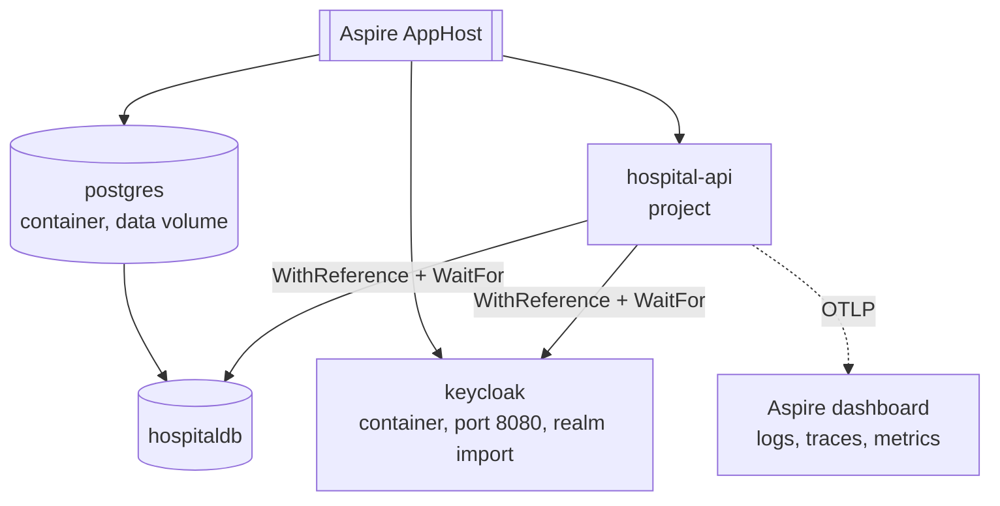
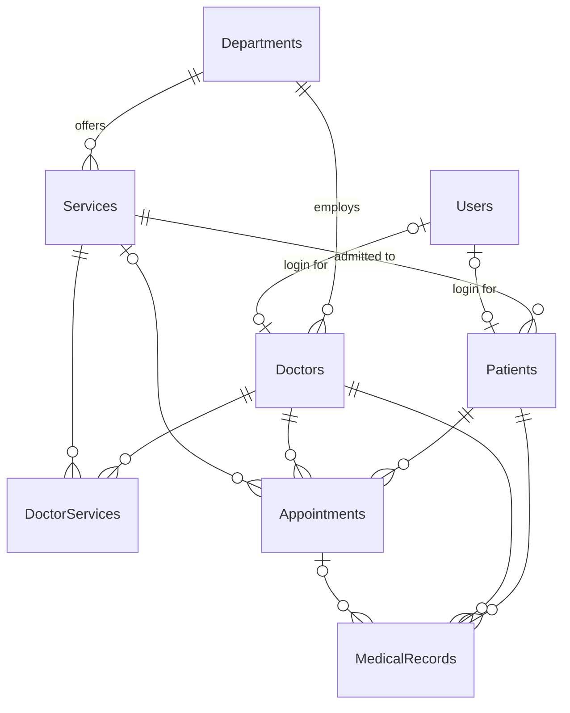

# Hospital Management System — Architecture

This document describes the backend platform: an ASP.NET Core API, PostgreSQL and Keycloak, runnable
with docker-compose or .NET Aspire. The endpoint-by-endpoint reference is in
[docs/API_ENDPOINTS.md](docs/API_ENDPOINTS.md).

## 1. System architecture



The API is a stateless **resource server**. It never sees passwords: users sign in at Keycloak and the API
only validates the tokens Keycloak issues.

### Solution layout (`backend/`)

| Project | Responsibility | Depends on |
|---|---|---|
| `Domain` | Entities, DTOs, role and audit-action constants. No framework dependencies. | – |
| `Data` | `ApplicationDbContext`, EF Core migrations, sample-data seed. | Domain |
| `Services` | Business rules, audit logging, external integration abstractions. | Domain, Data |
| `api` | HTTP: controllers, authentication, authorization policies, error handling, Swagger. | all of the above |
| `HospitalManagement.ServiceDefaults` | OpenTelemetry, health checks, service discovery, HTTP resilience. | – |
| `HospitalManagement.AppHost` | Aspire orchestration for development. Not deployed. | api |

Request path: `Controller → Service → DbContext`. Controllers decide *who may call*; services decide
*whether the operation is valid* and write the audit trail, so an operation is audited no matter which
controller triggers it.

The `backend/Service` folder (`Servicest.csproj`) is leftover scaffolding that is not part of the solution.

### Cross-cutting behaviour

| Concern | Where | Notes |
|---|---|---|
| Authentication | `api/Auth/AuthenticationExtensions.cs` | JWT bearer against Keycloak |
| Authorization | `api/Auth/Policies.cs` + `[Authorize]` on controllers | Fallback policy: everything needs a token |
| User mirroring, login audit | `api/Auth/UserSyncMiddleware.cs` → `UserService` | Runs after authentication |
| Errors | `api/Infrastructure/DbUpdateExceptionHandler.cs` | Constraint violations → 409 problem details |
| Health | `/health` (readiness, includes database), `/alive` (liveness) | Anonymous |
| Telemetry | ServiceDefaults | OTLP export when `OTEL_EXPORTER_OTLP_ENDPOINT` is set |
| CORS | `Cors:AllowedOrigins` | Explicit origin list; default `http://localhost:3000` |

## 2. Authentication flow

Interactive clients (the web front end, Swagger UI) use **authorization code + PKCE** with the public
client `hospital-web`.



What the API checks on every request:

| Check | Value |
|---|---|
| Signature | Realm signing keys, downloaded from `Keycloak:Authority` |
| Issuer (`iss`) | `Keycloak:Issuer`, or `Keycloak:Authority` when no separate issuer is set |
| Audience (`aud`) | `hospital-api` (added by an audience mapper on `hospital-web`) |
| Lifetime | Access tokens live 15 minutes; 30 seconds clock skew |

**Login auditing.** The API does not handle the login itself, so it detects one: each interactive login
creates a new Keycloak session id (`sid` claim). When a token arrives with a `sid` different from the
user's last recorded one, the API writes a `User.Login` audit entry. Refreshing a token keeps the same
session and does not create a new entry. Failed logins never reach the API; Keycloak records those in its
own event log, which is enabled in the realm file.

For scripts and manual testing, `hospital-web` also allows the password grant:

```bash
curl -X POST http://localhost:8080/realms/HospitalRealm/protocol/openid-connect/token \
  -d grant_type=password -d client_id=hospital-web \
  -d username=doctor.user -d 'password=Doctor123!'
```

Disable "Direct access grants" on the client before any real deployment.

## 3. Authorization model

Roles are Keycloak **realm roles**: `Admin`, `Doctor`, `Nurse`, `Patient`. Keycloak ships them in the
nested claim `realm_access.roles`; the API flattens them into one `roles` claim each so standard
ASP.NET Core role checks work.

Three layers, from coarse to fine:

1. **Fallback policy.** Any endpoint without an explicit rule requires an authenticated user. A new
   controller is therefore protected by default; anonymous access must be opted into with `[AllowAnonymous]`.
2. **Role policies** (`api/Auth/Policies.cs`).

   | Policy | Roles | Used for |
   |---|---|---|
   | `AdminOnly` | Admin | Master data writes, user management, audit log, hard deletes |
   | `Staff` | Admin, Doctor, Nurse | Patient administration, appointment updates |
   | `ClinicalStaff` | Doctor, Nurse | Reserved for clinical read endpoints |
   | `DoctorOnly` | Doctor | Writing medical records |

3. **Ownership checks** in controllers. A caller who is only a `Patient` can reach just the patient
   record linked to their account, and only appointments and medical records of that patient.

Design decisions worth knowing:

- **Admins cannot read medical records.** Administration and clinical access are separate duties.
- **Doctors and nurses see all patients.** There is no per-department or per-care-team restriction yet.
- **Deactivation is local.** `PUT /api/User/{id}/status` blocks a user in this API within the same
  instance immediately. Other API instances honour it within 5 minutes (per-instance cache). The Keycloak
  account stays usable for other applications; disable it in Keycloak to block sign-in entirely.

The full role matrix is at the end of [docs/API_ENDPOINTS.md](docs/API_ENDPOINTS.md).

## 4. Keycloak integration

Everything is declared in [keycloak/realms/HospitalRealm-realm.json](keycloak/realms/HospitalRealm-realm.json),
imported on first start by both docker-compose and Aspire. Keycloak requires the file name
`<realm>-realm.json`.

| Item | Value |
|---|---|
| Realm | `HospitalRealm` |
| Realm roles | `Admin`, `Doctor`, `Nurse`, `Patient` |
| Client `hospital-api` | Bearer-only. Represents the API as a token audience; cannot request tokens. |
| Client `hospital-web` | Public, authorization code + PKCE (S256). Adds `aud: hospital-api` to access tokens. |
| Redirect URIs | `http://localhost:3000/*` (front end), Swagger UI on ports 5117 and 7164 |
| Events | Login, logout and admin events are recorded by Keycloak |
| Brute-force protection | Enabled |

Development users (password in brackets): `admin.user` (`Admin123!`), `doctor.user` (`Doctor123!`),
`nurse.user` (`Nurse123!`), `patient.user` (`Patient123!`). These exist for local use only; remove them
from the realm file for any shared environment.

API configuration (`Keycloak` section, overridable with `Keycloak__*` environment variables):

| Key | Purpose | docker-compose | Aspire / local run |
|---|---|---|---|
| `Authority` | Where the API downloads realm metadata and keys | `http://keycloak:8080/realms/HospitalRealm` | `http://localhost:8080/realms/HospitalRealm` |
| `Issuer` | Expected `iss`, when different from `Authority` | `http://localhost:8080/realms/HospitalRealm` | not set |
| `Audience` | Expected `aud` | `hospital-api` | `hospital-api` |
| `RequireHttpsMetadata` | Refuse plain-HTTP Keycloak | `false` | `false` |

**Why two URLs in Docker.** A browser reaches Keycloak at `localhost:8080`, but inside the Docker network
the API reaches it at `keycloak:8080`. Keycloak is started with `KC_HOSTNAME=http://localhost:8080` so every
token carries the browser-facing issuer, and `KC_HOSTNAME_BACKCHANNEL_DYNAMIC=true` so the API can still
fetch keys over the internal address.

**User lifecycle.** Keycloak owns identities, credentials and roles. The API keeps a `Users` row per
identity, created on the first authenticated request and refreshed from the token (name, e-mail, primary
role). The row is what doctors, patients and audit entries reference. Role changes are made in Keycloak and
take effect with the next token.

## 5. Aspire topology

`backend/HospitalManagement.AppHost/AppHost.cs` describes the development topology:



| Resource | Type | Configuration injected into the API |
|---|---|---|
| `postgres` / `hospitaldb` | Container + database | `ConnectionStrings__hospitaldb` |
| `keycloak` | Container, fixed host port 8080 | `services__keycloak__http__0` (service discovery), `Keycloak__Authority` |
| `hospital-api` | .NET project | `Database__MigrateOnStartup=true`, `Database__SeedOnStartup=true`, OTLP endpoint |

- The API waits for the database and Keycloak to be healthy before it starts, and Aspire probes `/health`.
- `AddServiceDefaults()` in the API enables service discovery for `HttpClient`, so a future outbound call
  can use a logical address such as `http://keycloak`.
- Keycloak runs over plain HTTP on port 8080 (Aspire's default would be HTTPS with the dev certificate), so
  the token issuer is the same as in docker-compose and one realm file serves both.

Differences from docker-compose:

| | docker-compose | Aspire |
|---|---|---|
| API | Container built from `api/Dockerfile`, `Production` environment | Runs from source, `Development` environment |
| Keycloak storage | PostgreSQL database `keycloak` | Keycloak's embedded dev database; realm re-imported on each start |
| Observability | Container logs | Dashboard with logs, traces and metrics |

Both use Keycloak on host port 8080, so run one at a time.

```bash
docker compose up --build                                   # full platform in containers
dotnet run --project backend/HospitalManagement.AppHost     # Aspire, needs the .NET 10 SDK and Docker
```

## 6. Database architecture

One PostgreSQL server, two databases: `hospitaldb` (owned by the API through EF Core migrations) and
`keycloak` (owned by Keycloak; the API never touches it).



| Table | Purpose | Notes |
|---|---|---|
| `Doctors`, `Patients`, `Services`, `DoctorServices` | Original model | Gained `DepartmentId`, `UserId`, `Email` |
| `Departments` | Organisational unit grouping doctors and services | Unique name |
| `Users` | Local mirror of a Keycloak identity | Unique `KeycloakId`; `IsActive`; last login and session |
| `Appointments` | Patient–doctor booking | Status stored as text; index on (`DoctorId`, `ScheduledAt`) |
| `MedicalRecords` | Diagnosis, treatment, notes | Optional link to the appointment it came from |
| `AuditLogs` | Append-only audit trail | No foreign keys, so entries survive deletion of what they describe |

Rules enforced by the schema:

- A user can be linked to at most one doctor and one patient (unique indexes on `UserId`).
- A doctor or patient with appointments or medical records cannot be deleted (`RESTRICT`); the API returns 409.
- Deleting a department, service or user clears the reference instead of deleting dependants (`SET NULL`).
- All timestamps are `timestamp with time zone` in UTC; a model-wide converter normalises incoming values.

**Migrations.** `Data/Migrations` holds a single `InitialPostgres` migration; the earlier SQL Server
migration was replaced. With `Database:MigrateOnStartup=true` the API applies pending migrations when it
starts, retrying while the database comes up. That is convenient for a single instance. With several
instances, run migrations as a separate deployment step instead.

```bash
# set ConnectionStrings__hospitaldb and Keycloak__Authority first; any valid-looking values work for "add"
dotnet ef migrations add <Name> --project backend/Data --startup-project backend/api
```

### Audit logging

`IAuditService` writes to `AuditLogs` through its own `DbContext`, so an audit write is independent of the
business transaction and a failure to audit is logged without failing the request.

| Event | Action | Recorded details |
|---|---|---|
| User login | `User.Login` | Role, Keycloak session id |
| First sign-in | `User.Provisioned` | User name, role |
| Appointment creation | `Appointment.Created` | Patient, doctor, time |
| Appointment update, cancel | `Appointment.Updated` | Doctor, time and status before and after |
| Appointment deletion | `Appointment.Deleted` | Patient, doctor, time |
| Medical record creation | `MedicalRecord.Created` | Patient, doctor |
| Medical record update | `MedicalRecord.Updated` | Patient, names of changed fields (never the content) |
| User management | `User.Activated`, `User.Deactivated`, `User.Linked` | Target user, linked records |

Every entry also stores the timestamp, the acting user's Keycloak subject and user name, and the client IP.
Admins read the trail through `GET /api/AuditLog`.

Known limits: the audit write is not in the same transaction as the business change, so a crash between
the two loses the entry; and behind a reverse proxy the IP is the proxy's until forwarded headers are
configured.

## 7. External integration points

Abstractions live in `Services/Integrations` and are registered in
`Services/ServiceCollectionExtensions.cs` (`AddHospitalServices`).

| Interface | Role | Current implementation |
|---|---|---|
| `INotificationService` | Decides who is told what, over which channel | `NotificationService`: e-mail and SMS to the patient on appointment create and update |
| `IEmailService` | E-mail gateway | `LoggingEmailService`: logs recipient and subject, sends nothing |
| `ISmsService` | SMS gateway | `LoggingSmsService`: logs the number, sends nothing |
| `IAuditService` | Audit trail | `AuditService`: writes to PostgreSQL |

To connect a real provider, implement `IEmailService` or `ISmsService` and change one registration line.
Notifications are best effort: a provider failure is logged and does not fail the booking. Before real
traffic, move delivery to a background queue (outbox) so slow providers do not slow down requests.

Other integration points: Keycloak (OIDC discovery and JWKS over HTTP) and an OpenTelemetry collector
(OTLP, optional).

## 8. Configuration reference

| Setting | Purpose | Default |
|---|---|---|
| `ConnectionStrings:hospitaldb` | PostgreSQL connection string | none (required) |
| `Keycloak:*` | See section 4 | `Authority` required |
| `Database:MigrateOnStartup` | Apply migrations at startup | `false` (`true` in Development, compose, Aspire) |
| `Database:SeedOnStartup` | Insert sample data when tables are empty | `false` (`true` in compose, Aspire) |
| `Cors:AllowedOrigins` | Browser origins allowed to call the API | `http://localhost:3000` |
| `Swagger:Enabled` | Serve Swagger outside Development | `false` (`true` in compose) |

docker-compose reads `POSTGRES_USER`, `POSTGRES_PASSWORD`, `KEYCLOAK_ADMIN`, `KEYCLOAK_ADMIN_PASSWORD` and
`API_PORT` from `.env`; see [.env.example](.env.example). The built-in defaults are for local use only.

## 9. Gaps before production

- Keycloak runs in `start-dev` mode over HTTP. Production needs `start`, TLS and a real hostname.
- Secrets are environment variables with development defaults. Use a secret store.
- The front end (`frontend-web`) does not sign in through Keycloak yet, so its API calls return 401.
- `Patient.Phone` is an integer, which loses leading zeros and country codes.
- `ServiceController` accepts the EF entity as its request body; it should use a DTO like the newer endpoints.
- Doctors and nurses are not restricted to their own patients or department.
- No rate limiting, and the audit log has no retention policy.

## 10. Future testing opportunities

No automated tests exist yet. The structure was chosen so they can be added without refactoring:

| Level | Target | Approach |
|---|---|---|
| Unit | `AppointmentService` slot validation, `UserService` login detection and linking, `MedicalRecordService` changed-field audit | Services depend on interfaces (`ICurrentUserContext`, `IAuditService`, `INotificationService`), so fakes are trivial; use EF Core with SQLite in-memory or Testcontainers for the `DbContext` |
| Unit | Role flattening from `realm_access` | Extract `AddRealmRoles` and feed it sample claims |
| Integration | Every endpoint × every role (the role matrix) | `WebApplicationFactory<Program>` with a test authentication handler that issues the four roles; PostgreSQL via Testcontainers |
| Integration | Constraint handling (409 on delete with history, duplicate department) | Same host, real PostgreSQL |
| Integration | Token validation: wrong issuer, wrong audience, expired token | Keycloak Testcontainer importing the realm file |
| Contract | Stability of request and response shapes | Snapshot the generated OpenAPI document and diff it in CI |
| End-to-end | Login → book → update → record → audit trail | `Aspire.Hosting.Testing` to start the AppHost, or docker-compose in CI; Playwright for the browser login once the front end is integrated |
| Security | Unauthenticated and cross-patient access | Automated checks that every route returns 401 without a token and 403 across patients |
| Non-functional | Health endpoints, migration from an empty database, startup when the database is late | Compose-based smoke test in CI |

The manual checks run while building this (token issuance for all four roles, role and ownership rules,
double-booking, audit entries, deactivation) are the natural first candidates to automate.
