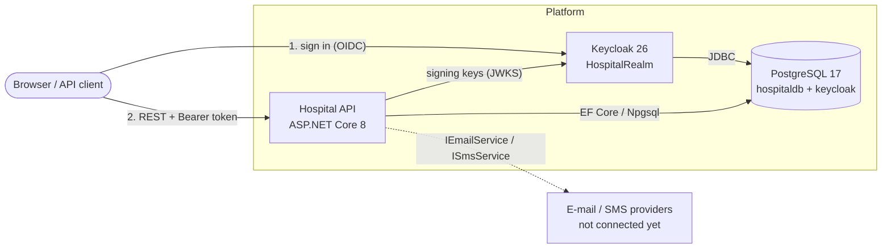
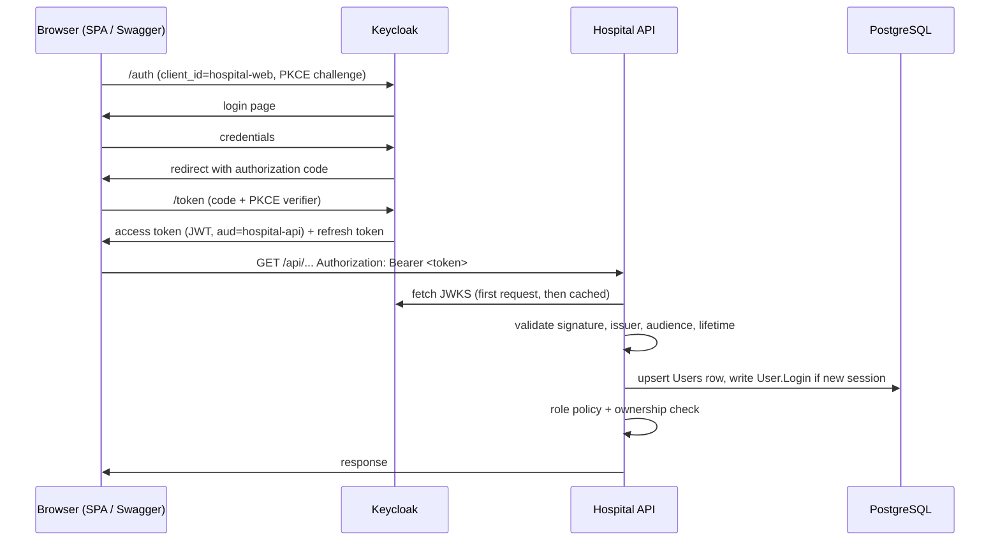
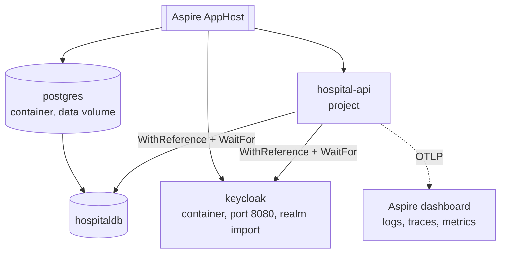
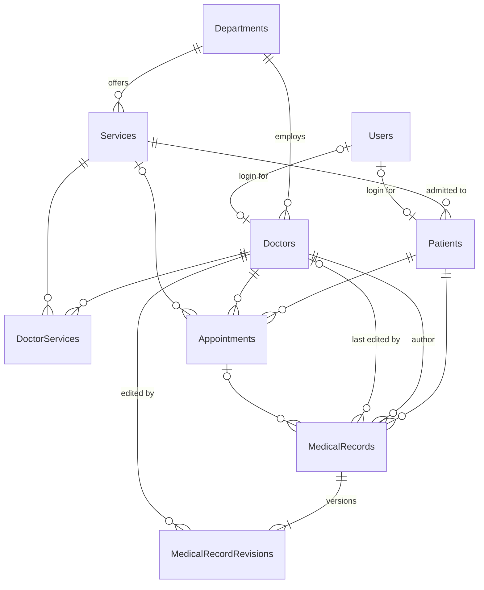

# Hospital Management System — Architecture

This document describes the backend platform: an ASP.NET Core API, PostgreSQL and Keycloak, runnable
with docker-compose or .NET Aspire. The endpoint-by-endpoint reference is in
[docs/API_ENDPOINTS.md](docs/API_ENDPOINTS.md).

## 1. System architecture



The API is a stateless **resource server**. It never sees passwords: users sign in at Keycloak and the API
only validates the tokens Keycloak issues.

### Solution layout (`backend/`)

| Project | Responsibility | Depends on |
|---|---|---|
| `Domain` | Entities, DTOs, role and audit-action constants. No framework dependencies. | – |
| `Data` | `ApplicationDbContext`, EF Core migrations, sample-data seed. | Domain |
| `Services` | Business rules, audit logging, external integration abstractions. | Domain, Data |
| `api` | HTTP: controllers, authentication, authorization policies, error handling, Swagger. | all of the above |
| `HospitalManagement.ServiceDefaults` | OpenTelemetry, health checks, service discovery, HTTP resilience. | – |
| `HospitalManagement.AppHost` | Aspire orchestration for development. Not deployed. Targets .NET 10. | api |
| `tests/HospitalManagement.UnitTests`, `tests/HospitalManagement.ApiTests` | Automated tests (§10) | Services; api |

The web front end (`frontend-web/`, React + TypeScript + Redux Toolkit) is a separate application that
signs in through Keycloak and calls the API with the access token (`frontend-web/src/auth/`).

Request path: `Controller → Service → DbContext`. Controllers decide *who may call* (role attributes and
ownership checks); services decide *whether the operation is valid* and write the audit trail.

**One service contract for every module** (decision D-16): a service takes and returns DTOs from
`Domain/Dtos` (never EF entities), returns `ServiceResult<T>` for operations that can fail
(`Ok`, `NotFound`, `Invalid`, `Conflict`, `Forbidden`, mapped to HTTP by `HospitalControllerBase.FromResult`),
accepts a `CancellationToken`, validates references instead of ignoring them, does not swallow exceptions,
and writes an audit entry for every change (ids and field names, never personal or clinical content).
Controllers return 201 with the created DTO and 204 for deletes.

The `backend/Service` folder (`Servicest.csproj`) is leftover scaffolding that is not part of the solution.

### Cross-cutting behaviour

| Concern | Where | Notes |
|---|---|---|
| Authentication | `api/Auth/AuthenticationExtensions.cs` | JWT bearer against Keycloak |
| Authorization | `api/Auth/Policies.cs` + `[Authorize]` on controllers | Default and fallback policy: everything needs a token with a hospital role |
| User mirroring, login audit | `api/Auth/UserSyncMiddleware.cs` → `UserService` | Runs after authentication |
| Write transactions | `api/Infrastructure/TransactionalWriteFilter.cs` | One database transaction per POST/PUT/PATCH/DELETE: change, audit entry, record revision and outbox messages commit together (D-8) |
| Side effects | `Services/Outbox`, `api/Infrastructure/OutboxDispatcher.cs` | Recorded in the outbox with the change, delivered afterwards with retries (§7) |
| Errors | `api/Infrastructure/DbUpdateExceptionHandler.cs` | Constraint violations → 409 problem details |
| Health | `/health` (readiness, includes database), `/alive` (liveness) | Anonymous |
| Telemetry | ServiceDefaults | OTLP export when `OTEL_EXPORTER_OTLP_ENDPOINT` is set |
| CORS | `Cors:AllowedOrigins` | Explicit origin list; default `http://localhost:3000` |

## 2. Authentication flow

Interactive clients (the web front end, Swagger UI) use **authorization code + PKCE** with the public
client `hospital-web`.



What the API checks on every request:

| Check | Value |
|---|---|
| Signature | Realm signing keys, downloaded from `Keycloak:Authority` |
| Issuer (`iss`) | `Keycloak:Issuer`, or `Keycloak:Authority` when no separate issuer is set |
| Audience (`aud`) | `hospital-api` (added by an audience mapper on `hospital-web`) |
| Lifetime | Access tokens live 15 minutes; 30 seconds clock skew |

**Login auditing.** The API does not handle the login itself, so it detects one: each interactive login
creates a new Keycloak session id (`sid` claim). When a token arrives with a `sid` different from the
user's last recorded one, the API writes a `User.Login` audit entry. Refreshing a token keeps the same
session and does not create a new entry. Failed logins never reach the API; Keycloak records those in its
own event log, which is enabled in the realm file.

**No password grant.** No client in the realm allows direct access grants (`grant_type=password`): a
password can only be entered on the Keycloak login page. Scripts and manual checks sign in through the
browser (front end or Swagger UI); the automated API tests use their own signing key and never need a
password (`docs/testing/TEST_STRATEGY.md` §5).

## 3. Authorization model

Roles are Keycloak **realm roles**: `Admin`, `Doctor`, `Nurse`, `Patient`. Keycloak ships them in the
nested claim `realm_access.roles`; the API flattens them into one `roles` claim each so standard
ASP.NET Core role checks work.

Four layers, from coarse to fine. Each kind of decision has exactly one home (decision D-9):

1. **Default and fallback policy.** Every endpoint with a bare `[Authorize]` or with no rule at all requires
   an authenticated user **with one of the hospital roles**. A token without a hospital role gets 403
   everywhere. A new controller is therefore protected by default; anonymous access must be opted into with
   `[AllowAnonymous]` (only `/health` and `/alive` do).
2. **Role policies** (`api/Auth/Policies.cs`).

   | Policy | Roles | Used for |
   |---|---|---|
   | `AdminOnly` | Admin | Master data writes, user management, audit log, hard deletes |
   | `Staff` | Admin, Doctor, Nurse | Patient administration, appointment updates |
   | `ClinicalStaff` | Doctor, Nurse | Medical record history |
   | `DoctorOnly` | Doctor | Writing medical records |

3. **Ownership: `IPatientAccessPolicy`** (`api/Auth/PatientAccessPolicy.cs`). The only place that decides
   *which patient's data* a caller may reach. Staff in the resource's scope (`Staff` = Admin, Doctor, Nurse;
   `ClinicalStaff` = Doctor, Nurse) reach every patient; anyone else reaches only the patient record linked to
   their account, and gets 403 both for someone else's id and for an id that does not exist.

   | Controller asks | Policy answers | Controller returns |
   |---|---|---|
   | `ListScopeAsync(scope)` | all patients / only patient *n* / nobody | the list filtered accordingly (empty for nobody) |
   | `CheckAsync(patientIdOfResource or null, scope)` | `Allow` / `NotFound` / `Forbidden` | the resource / 404 / 403 (`HospitalControllerBase.Denied`) |

   Controllers never resolve ownership themselves: an architecture test (`ArchitectureRulesTests`) fails the
   build if a controller calls `GetCurrentPatientIdAsync`, `IsInRole` or `IsStaff`. A doctor writes records
   as the doctor profile linked to their account; the author is never taken from the request.

4. **Business rules** in services. The appointment lifecycle (only a doctor marks `Completed`, final states
   cannot change) is enforced in `AppointmentService`; see *Appointment lifecycle* in
   [docs/API_ENDPOINTS.md](docs/API_ENDPOINTS.md).

Design decisions worth knowing:

- **Admins cannot read medical records.** Administration and clinical access are separate duties.
- **Medical records keep every version.** Any doctor may edit any record, but each change is stored as a
  new revision (`MedicalRecordRevisions`) with the editing doctor, in the same transaction as the edit.
- **The web frontend signs in through Keycloak** (`frontend-web/src/auth/`, keycloak-js, Authorization Code
  + PKCE). Tokens stay in memory, are refreshed before each API call, and logout ends the Keycloak session.
- **Doctors and nurses see all patients.** There is no per-department or per-care-team restriction yet.
- **Deactivation is local.** `PUT /api/User/{id}/status` blocks a user in this API within the same
  instance immediately. Other API instances honour it within 5 minutes (per-instance cache). The Keycloak
  account stays usable for other applications; disable it in Keycloak to block sign-in entirely.

The full role matrix is at the end of [docs/API_ENDPOINTS.md](docs/API_ENDPOINTS.md).

## 4. Keycloak integration

Everything is declared in [keycloak/realms/HospitalRealm-realm.json](keycloak/realms/HospitalRealm-realm.json),
imported on first start by both docker-compose and Aspire. Keycloak requires the file name
`<realm>-realm.json`.

| Item | Value |
|---|---|
| Realm | `HospitalRealm` |
| Realm roles | `Admin`, `Doctor`, `Nurse`, `Patient` |
| Client `hospital-api` | Bearer-only. Represents the API as a token audience; cannot request tokens. |
| Client `hospital-web` | Public, authorization code + PKCE (S256). Adds `aud: hospital-api` to access tokens. |
| Redirect URIs | `http://localhost:3000/*` (front end), Swagger UI on ports 5117 and 7164 |
| Events | Login, logout and admin events are recorded by Keycloak (kept 30 days) |
| Brute-force protection | Enabled |
| Direct access grants | Off on every client |
| Password reset ("Forgot password") | Off until an SMTP server is configured |

Sample users: `admin.user`, `doctor.user`, `nurse.user`, `patient.user`. The realm file holds no
password: it contains the placeholder `${DEV_USERS_PASSWORD}`, which Keycloak replaces with the
environment variable of that name when it first imports the realm. docker-compose takes the value from
`.env`; Aspire takes it from the `dev-users-password` parameter (user secrets). These users exist for
local use only; remove them from the realm file for any shared environment.

API configuration (`Keycloak` section, overridable with `Keycloak__*` environment variables):

| Key | Purpose | docker-compose | Aspire / local run |
|---|---|---|---|
| `Authority` | Where the API downloads realm metadata and keys | `http://keycloak:8080/realms/HospitalRealm` | `http://localhost:8080/realms/HospitalRealm` |
| `Issuer` | Expected `iss`, when different from `Authority` | `http://localhost:8080/realms/HospitalRealm` | not set |
| `Audience` | Expected `aud` | `hospital-api` | `hospital-api` |
| `RequireHttpsMetadata` | Refuse plain-HTTP Keycloak | `false` | `false` |

**Why two URLs in Docker.** A browser reaches Keycloak at `localhost:8080`, but inside the Docker network
the API reaches it at `keycloak:8080`. Keycloak is started with `KC_HOSTNAME=http://localhost:8080` so every
token carries the browser-facing issuer, and `KC_HOSTNAME_BACKCHANNEL_DYNAMIC=true` so the API can still
fetch keys over the internal address.

**User lifecycle.** Keycloak owns identities, credentials and roles. The API keeps a `Users` row per
identity, created on the first authenticated request and refreshed from the token (name, e-mail, primary
role). The row is what doctors, patients and audit entries reference. Role changes are made in Keycloak and
take effect with the next token.

## 5. Aspire topology

`backend/HospitalManagement.AppHost/AppHost.cs` describes the development topology:



| Resource | Type | Configuration injected into the API |
|---|---|---|
| `postgres` / `hospitaldb` | Container + database | `ConnectionStrings__hospitaldb` |
| `keycloak` | Container, fixed host port 8080 | `services__keycloak__http__0` (service discovery), `Keycloak__Authority` |
| `hospital-api` | .NET project | `Database__MigrateOnStartup=true`, `Database__SeedOnStartup=true`, OTLP endpoint |

- The API waits for the database and Keycloak to be healthy before it starts, and Aspire probes `/health`.
- `AddServiceDefaults()` in the API enables service discovery and the standard resilience handler for
  `HttpClient`. The API makes **no outbound HTTP call of its own today** (JWKS is fetched by the JWT
  handler), so these are unused until a real provider (e-mail, SMS) is connected.
- Keycloak runs over plain HTTP on port 8080 (Aspire's default would be HTTPS with the dev certificate), so
  the token issuer is the same as in docker-compose and one realm file serves both.

Differences from docker-compose:

| | docker-compose | Aspire |
|---|---|---|
| API | Container built from `api/Dockerfile`, `Production` environment | Runs from source, `Development` environment |
| Keycloak storage | PostgreSQL database `keycloak` | Keycloak's embedded dev database; realm re-imported on each start |
| Observability | Container logs | Dashboard with logs, traces and metrics |

Both use Keycloak on host port 8080, so run one at a time.

```bash
docker compose up --build                                   # full platform in containers
dotnet run --project backend/HospitalManagement.AppHost     # Aspire, needs the .NET 10 SDK and Docker
```

## 6. Database architecture

One PostgreSQL server, two databases: `hospitaldb` (owned by the API through EF Core migrations) and
`keycloak` (owned by Keycloak; the API never touches it).



`AuditLogs` stands alone on purpose: it has no foreign keys (see the table below).

| Table | Purpose | Notes |
|---|---|---|
| `Doctors`, `Patients`, `Services`, `DoctorServices` | Original model | Gained `DepartmentId`, `UserId`, `Email` |
| `Departments` | Organisational unit grouping doctors and services | Unique name |
| `Users` | Local mirror of a Keycloak identity | Unique `KeycloakId`; `IsActive`; last login and session |
| `Appointments` | Patient–doctor booking | Status stored as text; index on (`DoctorId`, `ScheduledAt`) |
| `MedicalRecords` | Current diagnosis, treatment, notes | Optional link to the appointment it came from (same patient and doctor); `LastEditedByDoctorId` |
| `MedicalRecordRevisions` | Every version of a record: content, changed fields, editing doctor, time | Unique (`MedicalRecordId`, `Revision`); revision 1 is the record as created; never updated or deleted |
| `AuditLogs` | Append-only audit trail | No foreign keys, so entries survive deletion of what they describe |

Rules enforced by the schema:

- A user can be linked to at most one doctor and one patient (unique indexes on `UserId`).
- A doctor or patient with appointments or medical records cannot be deleted (`RESTRICT`); the API returns 409.
- A service still used by patients cannot be deleted (`RESTRICT`, migration `PatientServiceRestrictDelete`;
  it used to cascade and delete the patients); the API also refuses while doctors offer it, with 409.
- Deleting a department or user clears the reference instead of deleting dependants (`SET NULL`); deleting a
  service clears it from appointments.
- All timestamps are `timestamp with time zone` in UTC; a model-wide converter normalises incoming values.

**Migrations.** `Data/Migrations` holds `InitialPostgres` (the earlier SQL Server migration was replaced)
and `MedicalRecordRevisions` (record history; gives existing records revision 1). With `Database:MigrateOnStartup=true` the API applies pending migrations when it
starts, retrying while the database comes up. That is convenient for a single instance. With several
instances, run migrations as a separate deployment step instead.

```bash
# set ConnectionStrings__hospitaldb and Keycloak__Authority first; any valid-looking values work for "add"
dotnet ef migrations add <Name> --project backend/Data --startup-project backend/api
```

### Audit logging

Two trails exist, both written **in the same transaction as the change** (decision D-8):

| Trail | Written | Guarantee | Readers |
|---|---|---|---|
| `MedicalRecordRevisions` | By `MedicalRecordService`, same `DbContext` and transaction as the record change | A record change cannot exist without its revision | Doctors, nurses (`GET /api/MedicalRecord/{id}/history`) |
| `AuditLogs` | By `IAuditService` through the request's `DbContext`, inside the write transaction (`TransactionalWriteFilter`) | A change cannot exist without its audit entry. **Fail closed:** if the audit write fails, the change is rolled back and the request gets 500 | Admins (`GET /api/AuditLog`) |

The clinical content lives only in the revisions; the audit log records who did what, never the content.
Sign-in events (`User.Login`, `User.Provisioned`) are written by the user sync before any action runs, in
their own short transaction.

| Event | Action | Recorded details |
|---|---|---|
| User login | `User.Login` | Role, Keycloak session id |
| First sign-in | `User.Provisioned` | User name, role |
| Appointment creation | `Appointment.Created` | Patient, doctor, time |
| Appointment update, cancel | `Appointment.Updated` | Doctor, time and status before and after |
| Admin status correction | `Appointment.StatusCorrected` | Old status, new status, reason |
| Appointment deletion | `Appointment.Deleted` | Patient, doctor, time |
| Medical record creation | `MedicalRecord.Created` | Patient, doctor |
| Medical record update | `MedicalRecord.Updated` | Patient, revision number, names of changed fields, editing doctor (never the content) |
| User management | `User.Activated`, `User.Deactivated`, `User.Linked` | Target user, linked records |
| Patient registry | `Patient.Created`, `Patient.Updated`, `Patient.Deleted` | Service id; names of changed fields (no personal data) |
| Doctor directory | `Doctor.Created`, `Doctor.Updated`, `Doctor.Deleted` | Department, service ids |
| Service catalogue | `Service.Created`, `Service.Updated`, `Service.Deleted` | Name, department |
| Departments | `Department.Created`, `Department.Updated`, `Department.Deleted` | Name |

Every entry also stores the timestamp, the acting user's Keycloak subject and user name, and the client IP.
Behind a reverse proxy the IP is the proxy's until forwarded headers are configured.

## 7. External integration points

Abstractions live in `Services/Integrations` and are registered in
`Services/ServiceCollectionExtensions.cs` (`AddHospitalServices`).

| Interface | Role | Current implementation |
|---|---|---|
| `INotificationService` | Records that a patient must be told something | `NotificationService`: writes an `AppointmentNotification` to the outbox on appointment create and update |
| `IOutbox` | Records a side effect with the current change | `Outbox`: a row in `OutboxMessages`, same transaction |
| `IOutboxHandler` | Delivers one type of outbox message | `AppointmentNotificationHandler`: looks up the patient's contact details and sends e-mail and SMS |
| `IEmailService` | E-mail gateway | `LoggingEmailService`: logs recipient and subject, sends nothing |
| `ISmsService` | SMS gateway | `LoggingSmsService`: logs the number, sends nothing |
| `IAuditService` | Audit trail | `AuditService`: writes to PostgreSQL in the request transaction |

**Outbox.** A booking never waits for, or fails because of, an e-mail or SMS provider:

```
request transaction:  appointment row  +  audit entry  +  OutboxMessages row   → commit (or none of them)
background:           OutboxDispatcher → OutboxProcessor → handler → IEmailService / ISmsService
```

- The payload holds ids and status only; contact details are read at delivery time, so the outbox never
  stores personal data.
- `OutboxDispatcher` (a hosted service in the API) runs the processor every `Outbox:PollIntervalSeconds`.
  Each batch is claimed with `FOR UPDATE SKIP LOCKED`, so several API instances can run it safely.
- A failed delivery is retried with exponential back-off (1, 2, 4, 8 minutes); after 5 attempts the message is
  marked `FailedAt` and kept for inspection. `LastError` holds the exception type and message only.
- Delivery is **at least once**: a crash after sending but before marking the message processed sends it
  again. Real providers should be given the message id as an idempotency key.

To connect a real provider, implement `IEmailService` or `ISmsService` and change one registration line.

Other integration points: Keycloak (OIDC discovery and JWKS over HTTP) and an OpenTelemetry collector
(OTLP, optional).

## 8. Configuration reference

| Setting | Purpose | Default |
|---|---|---|
| `ConnectionStrings:hospitaldb` | PostgreSQL connection string | none (required) |
| `Keycloak:*` | See section 4 | `Authority` required |
| `Database:MigrateOnStartup` | Apply migrations at startup | `false` (`true` in Development, compose, Aspire) |
| `Database:SeedOnStartup` | Insert sample data when tables are empty | `false` (`true` in `docker-compose.override.yml` and Aspire) |
| `Cors:AllowedOrigins` | Browser origins allowed to call the API | `http://localhost:3000` |
| `Swagger:Enabled` | Serve Swagger outside Development | `false` (`true` in `docker-compose.override.yml`) |
| `Outbox:Enabled` | Run the background outbox dispatcher in this instance | `true` |
| `Outbox:PollIntervalSeconds` | How often the dispatcher looks for due messages | `5` |

**Compose files.** `docker-compose.yml` holds the safe defaults: no sample data, no Swagger.
`docker-compose.override.yml` turns both on for local development and is loaded automatically by
`docker compose up`; `docker compose -f docker-compose.yml up` runs without it.

docker-compose reads `POSTGRES_USER`, `POSTGRES_PASSWORD`, `KEYCLOAK_ADMIN`, `KEYCLOAK_ADMIN_PASSWORD`,
`DEV_USERS_PASSWORD` and `API_PORT` from `.env`; see [.env.example](.env.example). The three passwords
have no default: the repository contains no credentials and compose refuses to start without them.

The web front end reads `VITE_API_URL` and `VITE_KEYCLOAK_URL`, `VITE_KEYCLOAK_REALM`,
`VITE_KEYCLOAK_CLIENT_ID` from `frontend-web/.env` (git-ignored, template `frontend-web/.envExample`); without
it the defaults match docker-compose.

## 9. Known architecture gaps

The production-readiness gaps (TLS, Keycloak production mode, secrets, backups, telemetry, …) are tracked
with ratings and a fix order in [docs/testing/RISK_REGISTER.md](docs/testing/RISK_REGISTER.md) §2.1–2.2 and
[docs/testing/QUALITY_GATES.md](docs/testing/QUALITY_GATES.md) §7. The structural gaps in the code itself:

| Gap | Where | Direction |
|---|---|---|
| **Failed outbox messages are only visible in the database** (`OutboxMessages.FailedAt`) | Outbox | An admin endpoint or a metric and alert (R-046) |
| **Mixed error contract.** ProblemDetails for validation and 409, plain text elsewhere, empty 403 bodies | Controllers, `HospitalControllerBase` | ProblemDetails everywhere |
| **Every `DbUpdateException` becomes 409** | `DbUpdateExceptionHandler` | Map only unique and foreign-key violations to 409 |
| **No optimistic concurrency**, no database constraint against overlapping bookings | Appointments, medical records | Concurrency token; exclusion constraint |
| **Instance-local state.** User-sync cache in memory; migrations and seed at startup | `UserService`, `DatabaseInitializer` | Decide single vs. multiple instances first (D-6) |
| **Domain model.** `Patient` requires a `Service`, has no identity fields, `Phone` is an integer; entities hold no behavior | `Domain/Entities` | Remodel `Patient`; move state transitions into the entities |
| **No paging** on list endpoints | All `GET` lists | One paging convention |
| **Leftover project** `backend/Service` (`Servicest.csproj`) | – | Delete |
| Doctors and nurses see all patients (no department or care-team restriction) | Authorization model (§3) | A product decision before it is a technical one |

## 10. Testing and CI

How the system is tested is described in [docs/testing/](docs/testing/README.md); this section only
records what the architecture provides for it.

| Test project | Uses from the architecture |
|---|---|
| `backend/tests/HospitalManagement.UnitTests` | Services depend on interfaces (`ICurrentUserContext`, `IAuditService`, `INotificationService`) and on `TimeProvider`, so business rules run with fakes and a fixed clock |
| `backend/tests/HospitalManagement.ApiTests` | `public partial class Program` lets `WebApplicationFactory<Program>` host the real pipeline; only the JWT signing key is replaced, so issuer, audience, lifetime and role mapping are the production code; PostgreSQL through Testcontainers |

`.github/workflows/ci.yml` builds the solution and the front end and runs both test projects (the API tests
on .NET 8 and .NET 10), the risk-coverage check and a secret scan on every pull request.

## 11. Decision log

Decisions already taken, so they are not reopened by accident, and decisions still open. Each open one
blocks the gap named next to it.

| ID | Decision | Status |
|---|---|---|
| D-1 | Modular monolith: one API, layered `Domain → Data → Services → api`; no microservices | Taken |
| D-2 | Keycloak owns identities, credentials and roles; the API is a resource server and mirrors users locally | Taken |
| D-3 | Every endpoint requires a hospital role unless it opts out with `[AllowAnonymous]` | Taken (`cd15a5e`) |
| D-4 | Medical records keep every version, saved in the same transaction as the edit | Taken (`871484e`) |
| D-5 | Synthetic data only, but everything built and tested as in production (`docs/testing/BUSINESS_FLOWS.md`) | Taken (Q-007) |
| D-6 | One API instance or several | **Open** (Q-008) — blocks the instance-local state gap (§9) |
| D-7 | Deployment target and reference topology (compose vs. Aspire publish vs. Kubernetes) | **Open** (Q-006) |
| D-8 | Atomic with the change: the audit entry, the record revision and the outbox messages (one transaction per write request; audit fails closed). Delivered afterwards, at least once: notifications | Taken (architecture review C-4) |
| D-9 | Where authorization decisions live: role attributes and policies for *which endpoints*, `IPatientAccessPolicy` for *which patient's data*, services for business invariants (§3); enforced by an architecture test | Taken (architecture review C-3) |
| D-10 | Error contract: ProblemDetails only | **Open** |
| D-11 | API contracts: where DTOs live, versioning, how the front end gets its types | **Open** |
| D-12 | Concurrency control mechanism | **Open** |
| D-13 | Time-zone contract of the API (offsets required?) | **Open** (R-051) |
| D-14 | Data lifecycle: soft or hard delete of patients, retention of audit log and revisions | **Open** |
| D-15 | Reference runtime: .NET 8 (API, container) vs. .NET 10 (AppHost) and the upgrade path | **Open** |
| D-16 | One service contract for every module: DTOs in and out, `ServiceResult<T>`, cancellation, audit of every change (§1) | Taken (architecture review C-2) |
