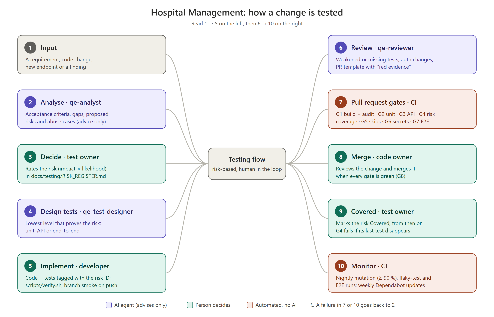

## Hospital Management System

The Hospital Management System is a project developed for managing hospital operations efficiently. It consists of a backend API built with ASP.NET Core EF 8, following the principles of Clean Architecture, and a web frontend developed using React TypeScript that signs in through Keycloak.

### Features

- CRUD operations for doctors
- CRUD operations for patients
- CRUD operations for services
- Relationship between doctors and services (many-to-many)
- Relationship between services and patients (one-to-many)

### Technologies Used

#### Backend (APIs)

- ASP.NET Core with Clean Architecture
- Entity Framework Core 8

#### Frontend (Web)

- React with TypeScript
- Axios for API requests
- Redux Toolkit for state management
- Ant Design (Antd) for UI components

## Getting Started

#### Setting up the Backend:

The backend is an ASP.NET Core API with PostgreSQL and Keycloak. See [ARCHITECTURE.md](ARCHITECTURE.md) for how it fits together and [docs/API_ENDPOINTS.md](docs/API_ENDPOINTS.md) for every endpoint.

**Option 1: Docker (everything in containers).** Requires Docker Desktop.

1. Copy `.env.example` to `.env` and set `POSTGRES_PASSWORD`, `KEYCLOAK_ADMIN_PASSWORD` and `DEV_USERS_PASSWORD`. No password is stored in the repository, and `.env` is git-ignored.
2. From the repository root run `docker compose up --build`. This also loads `docker-compose.override.yml`,
   which adds sample data and Swagger for local development. `docker compose -f docker-compose.yml up --build`
   runs without them.
3. Open Swagger at `http://localhost:5117/swagger` and click **Authorize** to sign in.
4. Keycloak admin console: `http://localhost:8080` (user and password from `.env`).

Sample sign-ins: `admin.user`, `doctor.user`, `nurse.user`, `patient.user`, all with the password you set in `DEV_USERS_PASSWORD`.

**Option 2: .NET Aspire (API and web frontend from source, with dashboard).** Requires Docker Desktop, the .NET 10 SDK and Node.js.

1. Set the sample users' password once: `dotnet user-secrets set "Parameters:dev-users-password" "<your password>" --project backend/HospitalManagement.AppHost`.
2. Run `dotnet run --project backend/HospitalManagement.AppHost`. This starts PostgreSQL, Keycloak, the API and the web
   frontend (Aspire runs `npm install` and `npm run dev` itself), so the frontend steps below are not needed.
3. Open the dashboard link printed in the console. The frontend is at `http://localhost:3000`, the API at `http://localhost:5117/swagger`.

Both options use port 8080 for Keycloak, so run one at a time. Migrations and sample data are applied automatically on startup.

#### What each sample user can do

The four sample users share the password set in step 1 (`DEV_USERS_PASSWORD` or `Parameters:dev-users-password`).
The API decides what each role may do; the full list per endpoint is the role matrix at the end of
[docs/API_ENDPOINTS.md](docs/API_ENDPOINTS.md).

| Sign in as | Web frontend (Doctors, Patients, Services pages) | API only (Swagger) |
|---|---|---|
| `admin.user` (Admin) | Everything: list, add, edit and delete doctors, patients and services | Departments, users and account links, audit log, appointment status corrections and deletes. No medical records |
| `doctor.user` (Doctor) | List doctors, patients and services. Add and Edit on the Patients page are still shown but refused (403) until the web frontend hides them (R-067) | Appointments (also marking them `Completed`); medical records, once an admin links the account to a doctor record |
| `nurse.user` (Nurse) | List doctors, patients and services; add and edit patients | Appointments; read medical records and their history |
| `patient.user` (Patient) | List doctors and services. The Patients page stays empty | Own appointments and medical records, once an admin links the account to a patient record |

Things to know when you try the frontend:

- **The frontend shows every button to every role.** Add, edit and delete are visible even when the role may
  not use them. The API refuses the request with 403, the page shows "You are not allowed to do this.", and the list or form
  does not change. Use `admin.user` to manage doctors and services.
- **The sample users are not linked to doctor or patient records.** Until an admin links them
  (`PUT /api/User/{id}/link`), `doctor.user` cannot write medical records and `patient.user` sees no own data.
- Appointments, medical records, departments, users and the audit log have no pages yet; use Swagger.

#### Setting up the Frontend (Web):

Only needed with Option 1; Aspire (Option 2) starts the frontend for you.

Open the frontend-web directory. `cd frontend-web`
Optional: copy `.envExample` to `.env` to change the API or Keycloak address (`.env` is git-ignored; without
it the defaults match docker-compose: API on 5117, Keycloak on 8080). Then sign in at `http://localhost:3000`
with one of the sample users.
Install dependencies:
`npm install`
Run the development server:
`npm run dev`
Or using docker:
`docker compose up`

## Contributing

    If you find any bugs or would like to optimize the code, feel free to contribute. Pull requests are welcome!

## Quality and testing

Every change is tested against the risks it could cause, and a person makes every decision. AI agents help to
find risks, design tests and review changes, but they only advise; the automated checks in CI never call an AI.

In short: a change starts as a requirement or a finding (1). It is analysed for risks (2), and the test owner
rates them in the risk register (3). Tests are designed at the lowest level that can prove each risk (4), written
together with the code (5) and reviewed (6). Every pull request must pass the automated gates (7) before the code
owner merges it (8); a risk counts as covered only once a passing test proves it (9). Nightly runs keep watching
(10), and any failure starts the loop again at step 2.

Details: [docs/testing/README.md](docs/testing/README.md).
