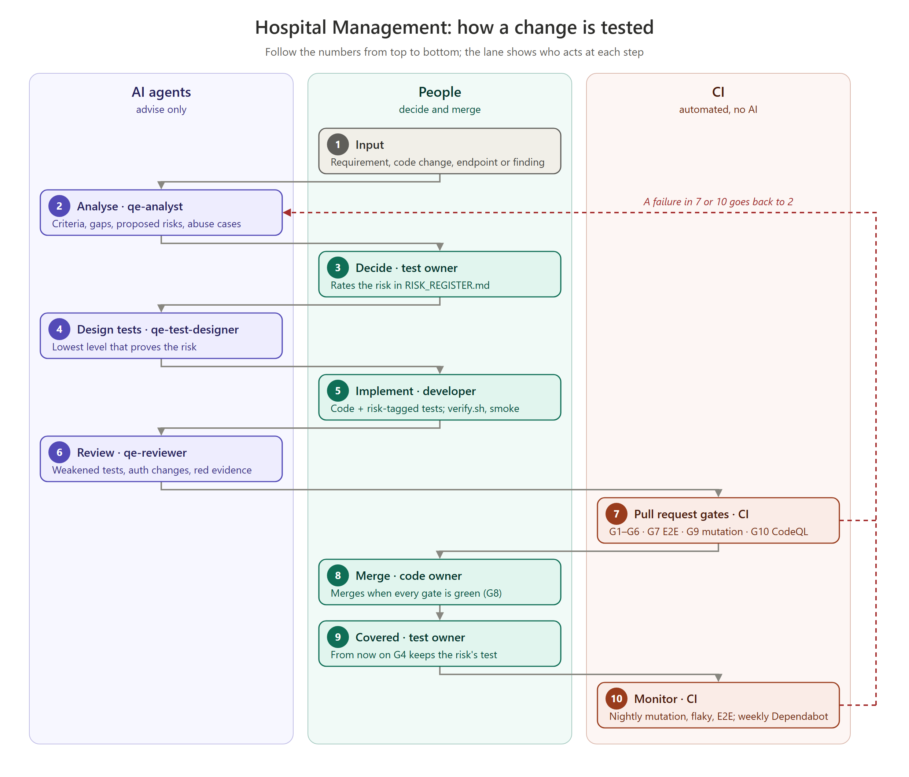

# Testing — Hospital Management

This folder describes how the Hospital Management platform is tested. The test suite is a **regular,
deterministic test project** (xUnit, Reqnroll, Playwright) that runs in GitHub Actions. AI agents
**assist the people** who design, write and review tests. Nothing in the pipeline depends on AI: if every
agent were removed tomorrow, every test and every quality gate would still run the same way.

## Testing philosophy

| Principle | What it means here |
|---|---|
| **Confidence over coverage** | There is no coverage-percentage gate. The gate is: every Critical and High risk has a passing test that would fail if the risk happened. |
| **Risk over quantity** | Every test traces to a risk ID (`[Trait("Risk", "R-001")]`). A test with no risk behind it is questioned in review. |
| **Reliability over speed** | No automatic retries, no `Thread.Sleep` / fixed waits, isolated test data. Every test arranges its own data and passes alone and in any order ([TEST_STRATEGY §8](TEST_STRATEGY.md#test-independence)). A flaky test is quarantined with an owner and a ticket — never silently skipped. |
| **Evidence over assumptions** | A claim cites code (`file:line`), a test, or a test run. Anything unproven is recorded as an assumption with an owner and a review date. |

**Operating principle: production-like, with synthetic data.** Everything is built, configured and tested
as close to real life and production as possible — real-life flows, health-data security with no leakage,
reliability, and every important scenario and edge case — while all data is fake. Details in
[BUSINESS_FLOWS.md](BUSINESS_FLOWS.md#operating-principle).

## Documents

| Document | Answers |
|---|---|
| [BUSINESS_FLOWS.md](BUSINESS_FLOWS.md) | The real-life flows of each actor, their edge cases, the synthetic data rules and the leakage checklist. |
| [TEST_STRATEGY.md](TEST_STRATEGY.md) | What we test at which level, with which tools, data and environments, and how tests are written. |
| [RISK_REGISTER.md](RISK_REGISTER.md) | How risks are rated, the current risks, the open assumptions, and which test covers which risk. |
| [SECURITY_TESTING.md](SECURITY_TESTING.md) | Who may call which endpoint, per-record access rules, token and leakage checks. |
| [UI_TEST_DESIGN.md](UI_TEST_DESIGN.md) | Tests for `frontend-web`: defects found, proposed risks, the test catalogue by category, open questions and automation approach. Which tests are implemented is stated at the top of the document. |
| [QUALITY_GATES.md](QUALITY_GATES.md) | What must pass before merge and release, the flaky-test and skip policy, and how failures and findings are handled. |

These documents are the **single source of truth**. Agents and skills point to them; they do not copy them.
This table says what each document *answers*, never what state it is in: a state written in two places goes
stale in one of them.

## Identifiers

Every item in these documents has an ID. An ID is **defined once**, as a row or a heading in the document
that owns it; everywhere else it is only referenced. When you meet an ID, open the document in the second
column. Its state (rating, status, answer) lives in that row only, and is changed in the same pull request
that changes it.

| ID, example | What it is | Defined in | Who raises it | Who decides | States |
|---|---|---|---|---|---|
| **F**-02, scenario F-02.6 | A business flow: what a real user does and the expected result. This is the requirement a test checks. | [BUSINESS_FLOWS §3](BUSINESS_FLOWS.md#3-flows) | Product owner, test owner | Product owner | A scenario is expected behaviour, or **Gap**: not handled yet, pointing to its risk |
| **R**-069 | A risk: something that *could* go wrong, rated Impact × Likelihood. | [RISK_REGISTER §2](RISK_REGISTER.md#2-risks); a web risk is first proposed in [UI_TEST_DESIGN §4](UI_TEST_DESIGN.md#4-proposed-risks) | Anyone; agents propose | Test owner: rating and status | `Proposed` → `Accepted` → `Covered` → `Closed`, or accepted for now in [§5](RISK_REGISTER.md#5-accepted-risks) |
| **A**-006 | An assumption: treated as true without proof, with an owner and a date to re-check. | [RISK_REGISTER §3](RISK_REGISTER.md#3-assumptions) | Anyone | Test owner | Open, Verified, Closed |
| **Q**-017 | A question no code or document answers. Its answer decides the expected result of a test. | [RISK_REGISTER §4](RISK_REGISTER.md#4-open-questions) | Anyone | A person: test owner or product owner, never an agent or the implementer | Open, or the answer with its date |
| **Q**-a … Q-l | A question raised while designing the web tests. One that went to the test owner got a Q-0nn row, which names its letter (Q-012 is Q-i). | [UI_TEST_DESIGN §7](UI_TEST_DESIGN.md#7-gaps-and-missing-requirements) | Test designer | As Q-0nn | Question (open), Answered |
| **D**-2 | A defect in the web frontend: something that *is* wrong now, with evidence. | [UI_TEST_DESIGN §3](UI_TEST_DESIGN.md#3-defects-found-while-designing) | Whoever finds it | Fixed in code; the risk it proves is decided as R | Fact (open), Fact, fixed |
| **UI**-HP-05 | A web test case. The middle part is its category: HP happy path, NEG negative, BND boundary, ST state, CON concurrency, DI data integrity, A11Y accessibility, RSP responsive, REL reliability, SEC security. | [UI_TEST_DESIGN §6](UI_TEST_DESIGN.md#6-test-catalogue) | Test designer | Test owner accepts it | Design, or implemented (listed at the top of UI_TEST_DESIGN) |
| **G**9 | A quality gate: a check every pull request must pass. | [QUALITY_GATES §1](QUALITY_GATES.md#1-gates) | – | A person: what is required in the repository settings | – |
| **C**-2 | A step of the architecture refactor, cited in a risk's "Fixed in". | Its commit message (`git log --grep "(C-2)"`) | – | – | – |

**One prefix, two series.** [ARCHITECTURE §11](../../ARCHITECTURE.md#11-decision-log) numbers its *decisions*
with D as well: ARCHITECTURE D-2 is "Keycloak owns identities", UI_TEST_DESIGN D-2 is a lost email. The rule:
inside ARCHITECTURE.md a D-number is one of its decisions; everywhere else a bare D-number is a web defect, and
a decision is written with the word right before it, `ARCHITECTURE D-9`. Gate G4 (e) checks it.

**Labels on statements.** Every finding is a *Fact* (with a citation someone else can open), an *Assumption*
(says what would prove it) or a *Question* (for a person). The rules are in
[evidence-rules](../../.claude/skills/evidence-rules/SKILL.md).

**Columns that recur.**

| Column | Meaning | Defined in |
|---|---|---|
| I, L, Severity | Impact and Likelihood (1–4); Severity = I × L: Low 1–3, Medium 4–6, High 8–9, Critical 12–16 | [RISK_REGISTER §1](RISK_REGISTER.md#1-risk-model) |
| STRIDE | Threat category: Spoofing, Tampering, Repudiation, Information disclosure, Denial of service, Elevation of privilege | [RISK_REGISTER §1](RISK_REGISTER.md#1-risk-model) |
| Level, Lvl | The lowest test level that can prove it: Unit, API, Component (Comp), E2E | [TEST_STRATEGY §2](TEST_STRATEGY.md#2-test-levels) |
| Sev | In the web test catalogue: the proposed severity of the risk the test proves | [UI_TEST_DESIGN §6](UI_TEST_DESIGN.md#6-test-catalogue) |
| Auto | Automation order: P1 first, then P2, then P3 | [UI_TEST_DESIGN §6](UI_TEST_DESIGN.md#6-test-catalogue) |

### How the IDs link

```
 Q  answers ──┐                         A  is assumed about it
              ▼                         ▼
 F  flow  ──► R  risk  ──► test  ──► G  gate
 what must    what could   names R     runs the test and checks the link
 happen       go wrong     and F
                ▲
 D  proves it ──┘
```

A test names its risk with `[Trait("Risk", "R-xxx")]` (`@R-xxx` in a frontend test title) and its flow
scenario with `[Trait("Scenario", "F-xx.y")]` (`@F-xx.y` in Gherkin). Gate G4 checks the right half of the
chain: every `Covered` risk keeps a test at its level, and every `Risk` trait names a risk that exists. G4 (e)
checks the IDs themselves: each is defined once in the section this legend names, and every ID mentioned in the
documents, agent and skill files and tests, scenario traits included, is defined
([QUALITY_GATES §1](QUALITY_GATES.md#1-gates)).

**Example.** The API let a doctor register patients, but flow F-02 says a nurse or an administrator does.
That contradiction became question **Q-017**; the test owner answered "follow F-02". The answer became risk
**R-069**, rated Critical (12). The fix was proven by `PatientWriteAccessTests`, which carries
`[Trait("Risk", "R-069")]` and `[Trait("Scenario", "F-02.6")]`, and G4 keeps that link from breaking.

## How the work flows



The picture is drawn by `docs/images/make_testing_flow.py` from one list of steps, which also draws the overview in
the root [Readme](../../Readme.md); change a step there and run the script again. The agents are named `qe-` for
quality engineering.

| # | Step | Who | What happens |
|---|---|---|---|
| 1 | Input | A person | A requirement, a code change, a new endpoint or a finding (QUALITY_GATES §6 has the finding template). |
| 2 | Analyse | `qe-analyst` | Turns it into acceptance criteria and finds gaps, proposed risks with ratings, abuse cases and security gaps. Advice only. |
| 3 | Decide | Test owner | Accepts or edits the risks and their ratings in [RISK_REGISTER.md](RISK_REGISTER.md). Open questions go to the product owner. |
| 4 | Design tests | `qe-test-designer` | Picks the lowest level that can prove each risk (unit, API or E2E) and drafts test cases, Gherkin and code as text. |
| 5 | Implement | Developer | Writes the code and the tests, each tagged `[Trait("Risk", "R-xxx")]`. `scripts/verify.sh` runs the CI gates locally; branch smoke checks run on every push. |
| 6 | Review | `qe-reviewer` | Looks for removed, skipped or weakened tests, missing risk tags and auth changes without security tests, and checks the other agents' output. The PR template asks for red evidence. |
| 7 | Pull request gates | CI | Every gate in [QUALITY_GATES.md §1](QUALITY_GATES.md#1-gates) (the list is kept there only): build, lint and audits, unit, component and API tests, risk coverage, skips, secrets, E2E, mutation of the changed lines, static analysis. |
| 8 | Merge | Code owner | Reviews the change and merges it once every gate is green (G8). |
| 9 | Covered | Test owner | Sets the risk to `Covered` when a passing test proves it; from then on G4 fails if that test disappears. |
| 10 | Monitor | CI | Nightly mutation testing of whole files (score at least 90 %), repeated runs that find flaky tests, nightly E2E, weekly CodeQL; Dependabot proposes updates weekly. |

A failure in step 7 or 10 starts the loop again at step 2. The reviewer also validates the analyst's and the test
designer's output, so no agent checks its own work, and no CI gate calls an AI agent.

### Running the workflow — what the R-053 pilot taught

The full loop was first run on R-053 (a medical record attached to a visit that never took place), on
2026-11-15/16:

1. **Pass outputs verbatim.** The reviewer validates what an agent actually said. A summary in between
   produced a false format failure; the analyst's and designer's text, and the diff, go to the reviewer
   whole (a diff as a file the reviewer reads).
2. **One step at a time.** Validate the design before implementing it, and review the diff only after it is
   final. A reviewer reading code that changes under it reports noise. Docs are updated after the change
   review, because the reviewer reads the register.
3. **Each agent reads its own definition first** (`.claude/agents/<name>.md`), so the brief stays short and
   the rules are the ones in the repo.
4. **Decisions go to the person.** Every Question from an agent was put to the product owner in business
   language; no agent and no implementer settled one.

What the agents caught that the implementer had not: stale citations in the register, that the 400 (not
yours) check must run before the 409 (wrong state) check so that a caller cannot learn the state of someone
else's appointment, wrong scenario traits, the `PUT` path to `NoShow` next to the correction path, and — in
the final change review — that a started, documented visit could be moved back into the future and then
cancelled (now F-05.7). It also listed what stays open: a write race (A-006), existing data (Q-011) and a
quiet unlink on delete (R-058).

## AI rules

1. **Agents do not change anything.** They read code and documents. They never edit files, commit, push, approve a
   pull request, change a risk rating or run in CI. One exception, decided by the test owner on 2026-11-27:
   `qe-reviewer` may run commands to check a claim, and only these: the .NET test projects (`dotnet test`, also
   for one class or test), the component tests, the gate scripts with `-I` and their unit tests, and the hook's own
   tests. A hook in its frontmatter denies every other Bash command (`.claude/hooks/restrict-agent-bash.mjs`, list
   in `.claude/hooks/agent-bash-policy.mjs`, tests in `.claude/hooks/restrict-agent-bash.test.mjs`).
   - **What it does not change:** the allowed commands still pass through the session's own permission rules.
     That is a prompt, unless an allow rule or the permission mode skips it. The hook never approves anything.
   - **What the commands write:** they build the code (`bin/`, `obj/`, test results), but they do not change
     source files. They run the code and scripts of the branch under review, including the hook's own list.
   - **When the hook does not protect:** the hook is skipped if the folder is not trusted in Claude Code, and it
     cannot block if `node` does not start. The permission rules are then the only check. In every other failure
     (unreadable input, a missing list, an error in the check) it blocks the command.
2. **People decide.** A person accepts every risk rating, every test and every merge. Code owners approve
   pull requests ([.github/CODEOWNERS](../../.github/CODEOWNERS)).
3. **Agent output is a proposal.** Every statement is labelled *Fact* (with a citation), *Assumption* or
   *Question*. Uncited statements are not used.
4. **Agents never weaken a test.** They never propose retries, skips, longer timeouts, broader assertions
   or deleting a failing test as a fix.
5. **No secrets or real patient data** are given to an agent. Test data is synthetic. This is enforced, not
   only asked for: [.claude/settings.json](../../.claude/settings.json) denies reading the local `.env`
   files and key files, for every Claude session in this repository.
6. **The implementer is governed too.** The rules above cover the three agents. The session that
   changes code — a person, or an AI coding session such as Claude Code — follows
   [The implementer](#the-implementer) below.

## The implementer

The implementer is whoever turns a design into a change: a person, or an AI coding session working for a
person. It is the one role that writes, so its limits are explicit.

| The implementer may | Only a person may |
|---|---|
| Edit code, tests and documents on a feature branch | Answer a **Question** (business rule, expected result, status code) |
| Run builds, tests and the gate scripts locally | Set a risk's rating or status in RISK_REGISTER (`Accepted`, `Covered`, `Closed`) |
| Run the agents and pass their output on | Confirm the PR template answers — above all "tests removed, skipped or loosened?" |
| Commit on the feature branch and push it (an AI session asks first) | Merge into `master` |
| Draft the PR description and the PR template answers | Change repository, GitHub or Keycloak settings |

Rules for an AI implementer:

1. **Hand-offs are verbatim.** Agent output, diffs and test output are passed to the next agent whole,
   never summarized (the R-053 pilot, lesson 1).
2. **One step at a time.** No implementation while a design is still being validated; no change review
   until the diff is final (lesson 2).
3. **Decisions are asked, not made.** Every Question goes to the person in business language, with the
   options and their consequences. A recommendation is allowed, but it is labelled as one, and the person's
   answer is recorded in RISK_REGISTER §4 with the date.
4. **Results are reported as they are.** Failing tests, skipped steps and anything not verified are stated
   in the PR; a test is never weakened to make it pass (AI rule 4 applies to the implementer too).
5. **Work is visible.** The PR says which agents ran and what they found.
6. **Limits are enforced where possible.** [.claude/settings.json](../../.claude/settings.json) denies
   force pushes, direct pushes to `master` and `git reset --hard`, and asks the person before every commit,
   push, merge and rebase. These rules match command prefixes, so they guard against mistakes, not against
   a session that sets out to get around them; branch protection on GitHub is the control that holds.

## Agents and skills

| Item | File | Purpose |
|---|---|---|
| Agent `qe-analyst` | [.claude/agents/qe-analyst.md](../../.claude/agents/qe-analyst.md) | Requirements → acceptance criteria, gaps, risks, abuse cases, security gaps |
| Agent `qe-test-designer` | [.claude/agents/qe-test-designer.md](../../.claude/agents/qe-test-designer.md) | Criteria and risks → test cases at the right level, Gherkin, draft code |
| Agent `qe-reviewer` | [.claude/agents/qe-reviewer.md](../../.claude/agents/qe-reviewer.md) | Change review, failure triage, validation of other agents' output |
| Skill `risk-model` | [.claude/skills/risk-model/SKILL.md](../../.claude/skills/risk-model/SKILL.md) | How an agent applies the risk model |
| Skill `evidence-rules` | [.claude/skills/evidence-rules/SKILL.md](../../.claude/skills/evidence-rules/SKILL.md) | How every agent cites evidence and formats its output |

Examples of use in Claude Code:

```
Use qe-analyst on POST /api/Appointment.
Use qe-test-designer for R-001 and R-004.
Use qe-reviewer on the current diff.
Use qe-reviewer to triage this failing test: <paste output>.
```

## Roles

| Role | Who | Responsibility |
|---|---|---|
| Test owner | Repository owner | Accepts risk ratings and assumptions, owns this folder, decides on quarantine and accepted risks. |
| Author | Whoever changes code | Writes or updates the tests for the risks their change touches. |
| Implementer | A person, or an AI coding session working for one | Writes the change within the limits in [The implementer](#the-implementer). An AI implementer is never the author of record: the person it works for is, and that person confirms the PR template. |
| Code owner | Listed in CODEOWNERS | Approves pull requests. Cannot be an agent. |

## Test projects

```
backend/tests/HospitalManagement.UnitTests/   business rules of every service, access policy,    phase 2 ✅, phase 3 ✅
                                               outbox delivery, architecture rules (fixed clock)
backend/tests/HospitalManagement.ApiTests/    authorization matrix, tokens, BOLA, record author, phase 2 ✅ — real PostgreSQL
                                               catalogue, transactions, outbox
frontend-web/src/**/*.test.ts(x)               forms, tables and slices of the web frontend —     2026-11-23 ✅
                                               Vitest in jsdom, API mocked with MSW
e2e/HospitalManagement.E2E/                    sign-in and clinical journeys — real Keycloak,      phase 4 ✅
                                               API, PostgreSQL and the production frontend build
```

Mutation testing (phase 5 ✅) checks that the tests notice broken rules: on every pull request for the lines it
changes (G9), and nightly for whole files — see [TEST_STRATEGY.md §11](TEST_STRATEGY.md#11-mutation-testing).

Risk/skip and documentation-reference checks run on every push to a non-`master` branch. All unit and API tests
run when backend code changes, and the frontend build and component tests run when `frontend-web/` changes. These provide early
feedback before a pull request exists and do not replace the required PR checks.

Run the E2E journeys against a running stack (`docker compose up -d --build`, then
`npm run build` and `npx vite preview --port 3000` in `frontend-web`), with the passwords from `.env`:

```bash
set -a; . ./.env; set +a; dotnet test e2e/HospitalManagement.E2E
```

Install Chromium once with `pwsh e2e/HospitalManagement.E2E/bin/Debug/net10.0/playwright.ps1 install chromium`.

Run them (Docker must be running for the API tests):

```bash
dotnet test backend/tests/HospitalManagement.UnitTests
dotnet test backend/tests/HospitalManagement.ApiTests
python3 scripts/check_test_gates.py
```

The API and every test project target .NET 10. Which workflow runs which gate: [QUALITY_GATES.md §1](QUALITY_GATES.md#1-gates). See [TEST_STRATEGY.md](TEST_STRATEGY.md)
for what belongs where.
